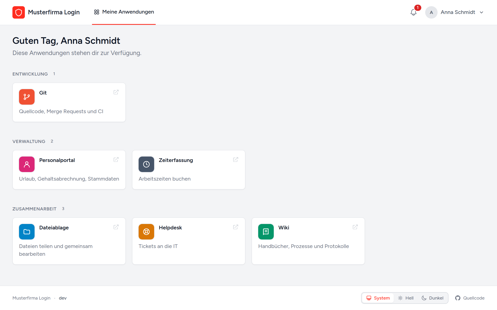
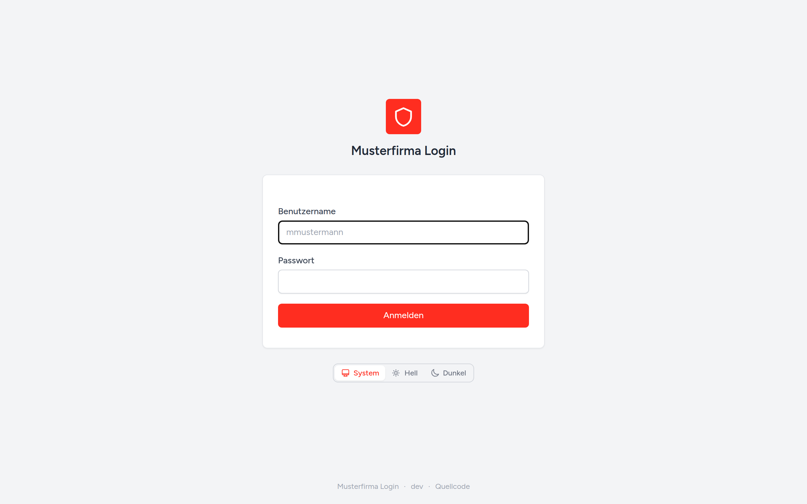
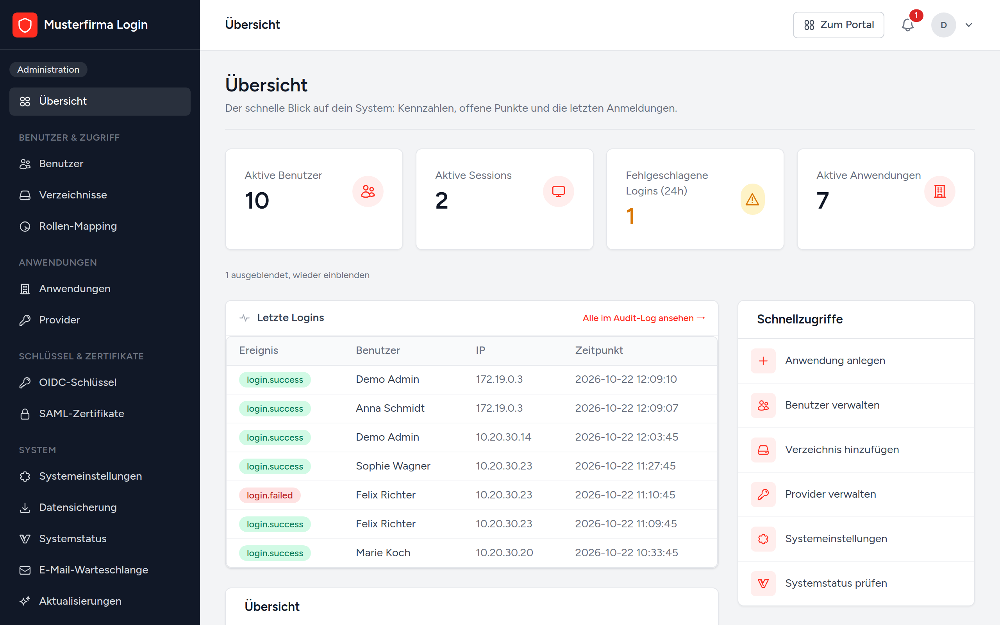
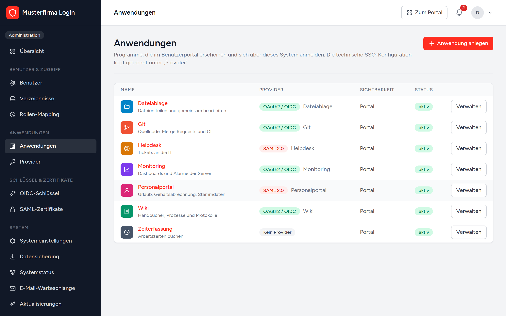
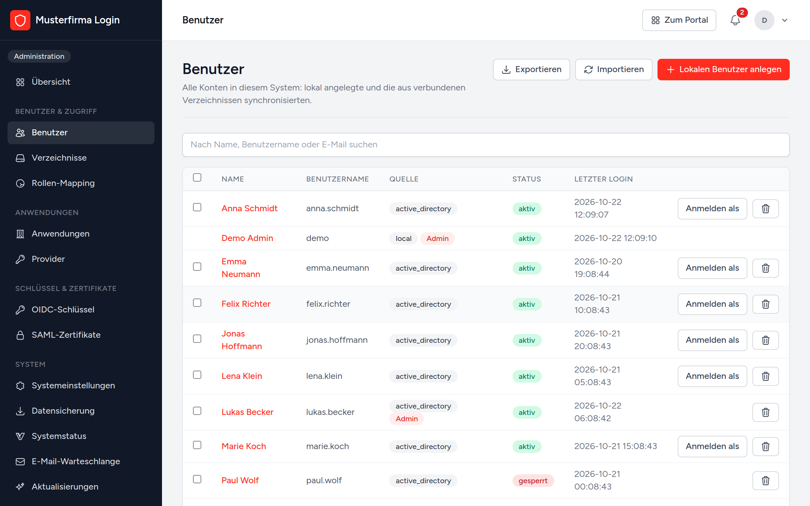
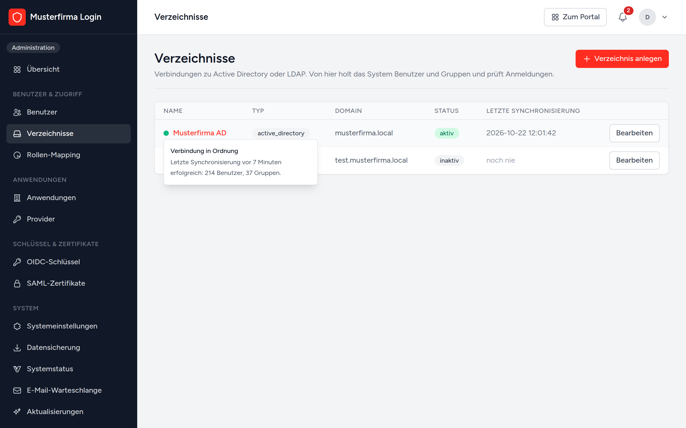
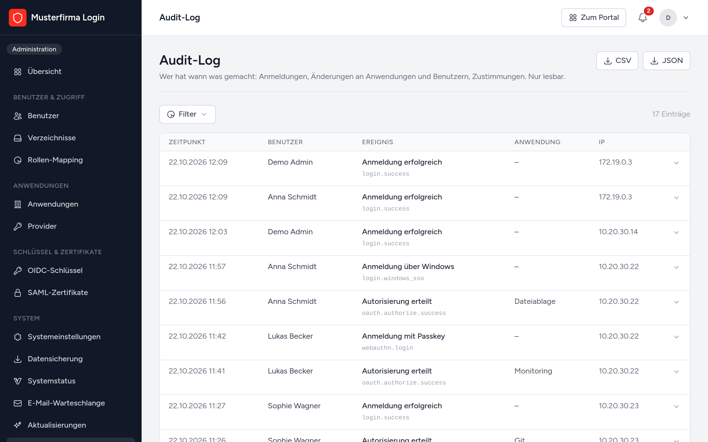
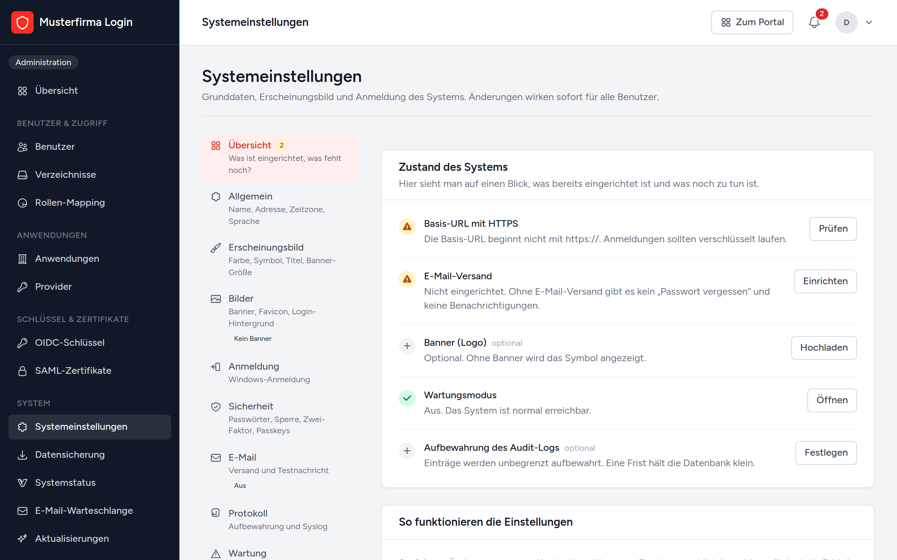

# Identity Provider

Eine zentrale Anmeldung für die Anwendungen im eigenen Haus. Benutzer melden
sich einmal an, mit Passwort, Passkey oder automatisch über Windows, und kommen
danach ohne weitere Anmeldung in Git, Wiki, Helpdesk und alles andere, was
OpenID Connect oder SAML spricht.

Die Konten kommen aus dem Active Directory, aus LDAP oder werden lokal angelegt.
Das System läuft als einzelner Docker-Container und bringt alles mit, was es
braucht. Kein Node, kein Build-Schritt, keine externen CDNs.



## Inhalt

- [Was es kann](#was-es-kann)
- [Screenshots](#screenshots)
- [Installation](#installation)
- [Demo ausprobieren](#demo-ausprobieren)
- [Anwendungen anbinden](#anwendungen-anbinden)
- [Active Directory und Windows-Anmeldung](#active-directory-und-windows-anmeldung)
- [Betrieb](#betrieb)
- [Weitere Dokumentation](#weitere-dokumentation)

## Was es kann

**Anmeldung**

- Lokale Konten, Active Directory und LDAP, auch mehrere Verzeichnisse gleichzeitig
- Windows-Anmeldung (Kerberos): im Firmennetz ohne Passworteingabe
- Passkeys und Authenticator-Apps als zweiter Faktor oder ganz ohne Passwort
- Vertrauenswürdige Geräte, Hinweis per E-Mail bei Anmeldung von einem neuen Gerät

**Für die Anwendungen**

- OAuth 2.0 und OpenID Connect (Authorization Code mit PKCE, Client Credentials, Refresh Token)
- SAML 2.0 mit signierten Assertions und Attribut-Mapping
- Single Logout: Wer sich abmeldet, ist überall abgemeldet
- SCIM 2.0: Benutzer und Gruppen werden in Zielanwendungen angelegt und aktuell gehalten
- Zugriff pro Anwendung nach Gruppe, Benutzer, IP-Bereich und Uhrzeit

**Verwaltung**

- Portal, in dem jeder Benutzer seine Anwendungen sieht
- AD-Gruppen auf Rollen abbilden, auch Administratoren aus dem AD
- Audit-Log, Sitzungsübersicht, Systemstatus
- Datensicherung des ganzen Systems in eine verschlüsselte Datei
- Prüft selbst auf neue Versionen und zeigt die Änderungen an

## Screenshots

Alle Bilder stammen aus der [Demo](#demo-ausprobieren) mit erfundenen Daten.

| | |
|---|---|
|  |  |
| Anmeldeseite | Übersicht für Administratoren |
|  |  |
| Anwendungen mit OIDC und SAML | Benutzer aus AD und lokale Konten |
|  |  |
| Verzeichnisse mit Status der Synchronisierung | Audit-Log |
|  | |
| Systemeinstellungen mit Übersicht, was noch fehlt | |

## Installation

Es gibt drei Wege. Für die meisten passt Docker.

| Weg | Passt, wenn |
|---|---|
| [Docker](#mit-docker) | ein Server mit Docker vorhanden ist. Am einfachsten zu aktualisieren. |
| [Skript](#mit-dem-skript-auf-einer-eigenen-vm) | eine frische Debian- oder Ubuntu-VM nur für dieses System bereitsteht |
| [Von Hand](docs/DEPLOYMENT.md#weg-3-von-hand) | es in eine bestehende Serverlandschaft ohne Docker soll |

Für alle Wege gilt: Davor gehört ein Reverse Proxy mit HTTPS (nginx, Traefik,
Caddy, IIS). OpenID Connect, SAML und Passkeys funktionieren nur über HTTPS.

### Mit Docker

Vom Projekt werden nur zwei Dateien gebraucht, nicht der ganze Quellcode.

```bash
mkdir auth && cd auth
curl -O https://raw.githubusercontent.com/kzg-software/identity-provider/main/docker-compose.yml
curl -o .env https://raw.githubusercontent.com/kzg-software/identity-provider/main/.env.docker.example
```

In der `.env` diese Werte anpassen:

```dotenv
APP_IMAGE=ghcr.io/kzg-software/identity-provider:latest
APP_URL=https://auth.firma.de
DB_PASSWORD=ein-langes-passwort
DB_ROOT_PASSWORD=ein-anderes-langes-passwort
TRUSTED_PROXIES=*
```

Starten:

```bash
docker compose up -d
```

Der Container lauscht auf Port 8080. Den Reverse Proxy dorthin zeigen lassen
und `https://auth.firma.de` öffnen. Ab da führt der Einrichtungsassistent
weiter.

Wer nur einen kleinen Bestand hat oder testen will, kommt ohne MariaDB aus:
`docker-compose.sqlite.yml` statt `docker-compose.yml` verwenden und in der
`.env` `DB_CONNECTION=sqlite` setzen.

Läuft auf dem Server noch kein Docker:

```bash
curl -sSL https://get.docker.com/ | CHANNEL=stable bash
sudo systemctl enable --now docker
```

**Update:** Die Datenbank wird beim Start automatisch angepasst. Vorher eine
Datensicherung anlegen schadet nie.

```bash
docker compose pull
docker compose up -d
```

### Mit dem Skript auf einer eigenen VM

Das Skript richtet nginx, PHP, Zertifikat, Datenbank und Scheduler ein. Updates
laufen danach ohne Downtime, ein Rollback ist ein Befehl.

```bash
git clone https://github.com/kzg-software/identity-provider.git
cd identity-provider
sudo DOMAIN=auth.firma.de bash deploy/install.sh
```

Update und Rollback, ebenfalls aus dem geklonten Verzeichnis:

```bash
sudo bash deploy/update.sh
sudo bash deploy/rollback.sh previous
```

Alle Optionen (MariaDB statt SQLite, eigenes Zertifikat, Git-Zugang) stehen in
[`deploy/README.md`](deploy/README.md).

### Einrichtungsassistent

Beim ersten Aufruf fragt das System, ob es neu eingerichtet oder aus einer
Sicherung wiederhergestellt werden soll. Die Neueinrichtung geht in sieben
Schritten durch Systemprüfung, Datenbank, Name und Adresse, ein lokales
Administratorkonto, Active Directory und Windows-Anmeldung. AD und
Windows-Anmeldung lassen sich überspringen und später nachholen. Danach sperrt
sich der Assistent.

## Demo ausprobieren

Eine Demo mit erfundenen Benutzern, Anwendungen und Einträgen im Audit-Log, wie
auf den Screenshots. Dafür reicht Docker:

```bash
git clone https://github.com/kzg-software/identity-provider.git
cd identity-provider
cp .env.docker.example .env
```

In der `.env` diese Werte setzen:

```dotenv
APP_PORT=80
APP_URL=http://localhost
DB_CONNECTION=sqlite
SESSION_SECURE_COOKIE=false
```

Dann:

```bash
docker compose -f docker-compose.sqlite.yml up -d --build
docker compose -f docker-compose.sqlite.yml exec app php artisan db:seed --class=DemoSeeder --force
```

Unter http://localhost anmelden:

| Benutzer | Passwort | Rolle |
|---|---|---|
| `demo` | `demo` | Administrator |
| `anna.schmidt` | `demo` | normale Benutzerin, sieht nur das Portal |

Die Demo-Daten lassen sich nur in eine leere Datenbank einspielen. Für den
echten Betrieb also nicht verwenden, sondern den Einrichtungsassistenten.

Ohne Docker geht es mit PHP 8.3 oder neuer und Composer:

```bash
composer install
cp .env.example .env
php artisan key:generate
php artisan migrate --seed --seeder=DemoSeeder
php artisan serve
```

## Anwendungen anbinden

Eine Anwendung wird unter **Administration → Anwendungen** angelegt. Dort steht
auch, wie sie im Portal erscheint und wer sie benutzen darf. Die technische
Seite (Client-ID, Redirect-URIs, Zertifikate) liegt unter **Provider**. Der
Assistent beim Anlegen erledigt beides in einem Zug.

### OpenID Connect

Die meisten Anwendungen brauchen nur die Discovery-URL, Client-ID und Secret:

```
https://auth.firma.de/.well-known/openid-configuration
```

| Zweck | Adresse |
|---|---|
| Discovery | `GET /.well-known/openid-configuration` |
| Schlüssel (JWKS) | `GET /.well-known/jwks.json` |
| Autorisierung | `GET /oauth/authorize` |
| Token | `POST /oauth/token` |
| UserInfo | `GET` oder `POST /oauth/userinfo` |
| Token widerrufen | `POST /oauth/revoke` |

Das Client-Secret ist nur direkt nach dem Anlegen im Klartext zu sehen. Die
Signaturschlüssel werden unter **OIDC-Schlüssel** rotiert.

<details>
<summary>Ablauf Authorization Code mit PKCE</summary>

```
1. code_verifier und code_challenge (S256) erzeugen, dazu einen zufälligen state
2. Weiterleiten auf
   GET /oauth/authorize?response_type=code&client_id=...&redirect_uri=...
       &scope=openid profile email groups&state=...
       &code_challenge=...&code_challenge_method=S256
3. Nach Anmeldung kommt der Benutzer mit ?code=...&state=... zurück
4. Code eintauschen:
   POST /oauth/token
   grant_type=authorization_code&code=...&redirect_uri=...&client_id=...&code_verifier=...
   Antwort: access_token, id_token, refresh_token, expires_in
5. id_token gegen /.well-known/jwks.json prüfen (RS256, kid im Header)
```

</details>

### SAML 2.0

Im Service Provider die Metadata dieser Anwendung einlesen, dann hier Entity ID
und ACS-URL des Service Providers eintragen.

| Zweck | Adresse |
|---|---|
| Metadata pro Anwendung | `GET /saml/{anwendung}/metadata` |
| Metadata allgemein | `GET /saml/metadata` |
| Anmeldung (SSO) | `GET` oder `POST /saml/sso` |
| Abmeldung (SLO) | `GET` oder `POST /saml/slo` |

Standardmäßig gehen `uid`, `mail`, `displayName`, `department` und `groups`
mit. Das Mapping lässt sich pro Anwendung ändern. Zertifikate liegen unter
**SAML-Zertifikate**, mit Rotation und Warnung vor dem Ablauf. Signierte
AuthnRequests müssen über das POST-Binding kommen.

### Abmeldung, Zugriff und Provisionierung

- **Single Logout:** Bei OpenID Connect schickt das System einen signierten
  Logout-Token an die Back-Channel-Logout-URL der Anwendung. Bei SAML bekommt
  jeder Service Provider mit SLO-URL eine LogoutRequest über den Browser. Der
  Service Provider muss dafür das Einbetten in einen Frame erlauben.
- **Zugriff nach Netz und Uhrzeit:** Im Tab *Zugriff* lassen sich IP-Bereiche
  (auch CIDR, IPv4 und IPv6) und Zeiten wie `Mo-Fr 08:00-18:00` eintragen. Hinter
  einem Reverse Proxy muss `TRUSTED_PROXIES` gesetzt sein.
- **SCIM:** Im Tab *Provisionierung* SCIM-URL und Token der Zielanwendung
  eintragen. Benutzer mit Zugriff werden dort angelegt, wer den Zugriff verliert,
  wird deaktiviert oder gelöscht. Der Abgleich läuft alle 10 Minuten.

## Active Directory und Windows-Anmeldung

Verzeichnisse werden unter **Administration → Verzeichnisse** eingetragen.
Nötig sind ein Dienstkonto mit Lesezugriff auf Benutzer und Gruppen (kein Domain
Admin) und die Base DN, etwa `DC=firma,DC=local`. LDAPS auf Port 636 ist
empfohlen.

- Der Punkt vor jedem Verzeichnis zeigt, ob die letzte Synchronisierung
  geklappt hat. Beim Darüberfahren steht, woran es hakt.
- Verbindung testen, Benutzer und Gruppen suchen und eine Testanmeldung gibt es
  direkt in der Detailansicht.
- Synchronisiert wird täglich komplett und auf Wunsch alle zehn Minuten nur das
  Geänderte. Verschachtelte Gruppen werden aufgelöst.
- Anmeldung und Synchronisierung lassen sich auf bestimmte Gruppen beschränken.
- Unter **Rollen-Mapping** werden AD-Gruppen zu Rollen, zum Beispiel `admin`.
  Der lokale Administrator bleibt als Notzugang immer erhalten.

Für die **Windows-Anmeldung** prüft der Webserver das Kerberos-Ticket und reicht
den Benutzernamen als `REMOTE_USER` weiter. Das System sucht den Benutzer im AD,
gleicht ihn ab und meldet ihn an.

- **IIS:** Windows-Authentifizierung an, anonyme aus, `Negotiate` vor `NTLM`,
  SPN registrieren (`setspn -S HTTP/auth.firma.local FIRMA\svc-auth`).
- **Apache:** `mod_auth_gssapi` mit Keytab.
- **nginx** kann kein Kerberos. Apache oder IIS davorstellen oder den
  eingebauten Endpunkt `/auth/negotiate` nutzen. Der prüft den gemeldeten Namen
  aber nicht gegen den Domain Controller und ist nur für abgeschottete Netze
  gedacht.

Die ausführliche Anleitung mit Beispielkonfigurationen zeigt der
Einrichtungsassistent im Schritt Windows-Anmeldung.

## Betrieb

- **Scheduler:** Muss laufen, sonst gibt es keine AD-Synchronisierung, keine
  Sicherungen und keine Update-Prüfung. In Docker ist er schon dabei, sonst per
  Cron: `* * * * * php artisan schedule:run`
- **Datensicherung:** Unter **Datensicherung** das ganze System (Datenbank,
  Einstellungen, Uploads) in eine verschlüsselte Datei sichern. Damit lässt sich
  auch ein frischer Server im Einrichtungsassistenten wieder aufbauen.
  Details in [`docs/BACKUP.md`](docs/BACKUP.md).
- **Systemstatus:** Datenbank, Cache, Queue, Scheduler, AD-Verbindungen und der
  Ablauf von Schlüsseln und Zertifikaten auf einer Seite.
- **Sicherheit:** Rate Limiting auf Anmeldung und Token-Endpunkten,
  Bind-Passwörter und Secrets nur verschlüsselt gespeichert, alle wichtigen
  Aktionen im Audit-Log.
- **Passkeys** brauchen HTTPS und einen festen Hostnamen. Weicht der Hostname
  von `APP_URL` ab, `WEBAUTHN_RP_ID` setzen.

## Weitere Dokumentation

| Datei | Inhalt |
|---|---|
| [`docs/DEPLOYMENT.md`](docs/DEPLOYMENT.md) | Alle Installationswege im Detail, Reverse Proxy, Betrieb |
| [`deploy/README.md`](deploy/README.md) | Installations- und Update-Skripte für eine eigene VM |
| [`docs/BACKUP.md`](docs/BACKUP.md) | Datensicherung und Wiederherstellung |
| [`docs/INSTANZEN.md`](docs/INSTANZEN.md) | Umbenennen, Adresse ändern, Test- und Produktivinstanz |
| [`CONTRIBUTING.md`](CONTRIBUTING.md) | Entwicklungsumgebung und Tests (`php artisan test`) |

## Lizenz

Siehe [`LICENSE`](LICENSE). Nutzen, ändern und weitergeben ist erlaubt, solange
der Urheberhinweis bleibt und bei sichtbarem Betrieb ein Link auf dieses Projekt
gesetzt wird.
